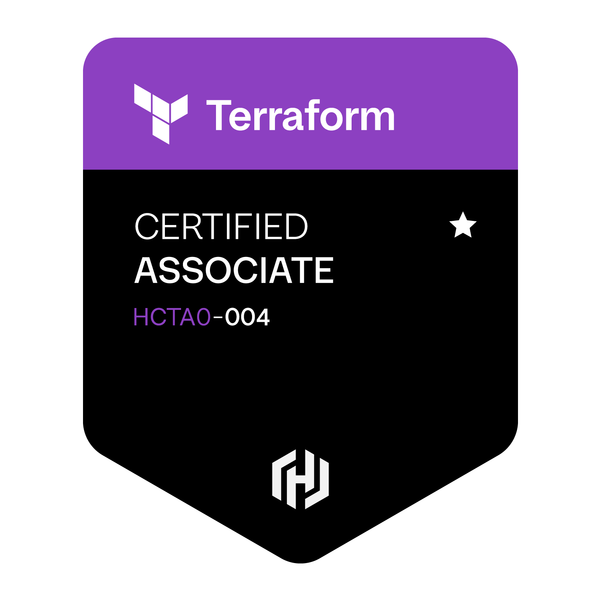

# HashiCorp Certified: Terraform Associate (004)

  

  
  
  

## Overview

| | |
|---|---|
| **Certification** | HashiCorp Certified: Terraform Associate (004) |
| **Holder** | Hovhannes Hovhannisyan |
| **Issued by** | IBM Professional Certification (HashiCorp, an IBM Company) |
| **Issued on** | October 5, 2026 |
| **Expires on** | October 5, 2028 |
| **Exam format** | Multiple choice, online proctored, 1 hour |
| **Terraform version tested** | 1.12 |
| **Verification** | [Credly badge](https://www.credly.com/badges/a1317b09-f81c-4294-9f07-9743b3d2c57d) |

## About the certification

The Terraform Associate certification is for cloud engineers who know the fundamentals of
**Terraform Community Edition** and **HCP Terraform**. It shows that the holder understands
Infrastructure as Code (IaC) and can use Terraform to provision, change, and manage infrastructure
across cloud providers and on-premises environments.

**Earning criteria:** pass the HashiCorp Certified: Terraform Associate multiple-choice exam.
([Official exam page](https://developer.hashicorp.com/certifications/terraform-associate))

## What the exam covers

### 1. Infrastructure as Code (IaC) with Terraform
- What IaC is and why it helps
- How Terraform works across multi-cloud, hybrid, and service-agnostic setups

### 2. Terraform Fundamentals
- Installing providers and pinning their versions
- How Terraform uses providers, including configurations with more than one provider
- How Terraform tracks infrastructure in state

### 3. Core Terraform Workflow
- `init` → `validate` → `plan` → `apply` → `destroy`
- Formatting and style conventions (`terraform fmt`)

### 4. Terraform Configuration
- `resource` vs `data` blocks, and references between resources
- Input variables, outputs, and complex types
- Expressions, functions, and dynamic blocks
- Implicit and explicit dependencies (`depends_on`)
- Custom conditions (validation rules, preconditions and postconditions)
- Handling sensitive data and secrets, including with HashiCorp Vault

### 5. Terraform Modules
- Module sources (local, registry, Git, and others)
- Variable scope inside modules
- Using modules and managing their versions

### 6. Terraform State Management
- Local backend and state locking
- Remote state with the `backend` block
- Detecting and fixing resource drift

### 7. Maintaining Infrastructure with Terraform
- Importing existing infrastructure (`import` blocks and `terraform import`)
- Inspecting state from the CLI (`terraform state list/show/mv/rm`)
- Verbose logging for debugging (`TF_LOG`)

### 8. HCP Terraform
- Provisioning infrastructure with HCP Terraform
- Collaboration and governance features (policies, run workflows, team access)
- Organizing work into workspaces and projects
- VCS and other integrations

## Skills

`Terraform` · `HashiCorp Terraform` · `Infrastructure as Code (IaC)` · `Terraform CLI` ·
`Terraform Workflow` · `Terraform Configuration` · `Terraform Modules` · `Terraform State` ·
`HCP Terraform` · `Terraform Cloud` · `Terraform Enterprise Awareness` · `Infrastructure Automation` ·
`Cloud Infrastructure` · `Multi-Cloud` · `IT Infrastructure` · `Cloud Engineer`

## Verification

You can verify this credential on Credly:
**https://www.credly.com/badges/a1317b09-f81c-4294-9f07-9743b3d2c57d**
